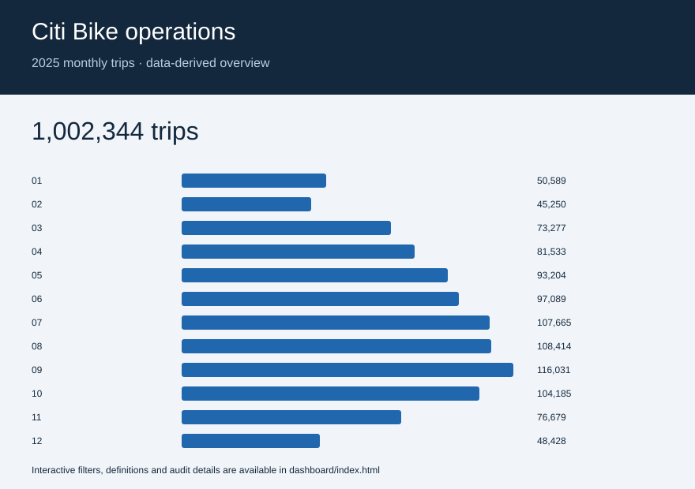

# Citi Bike Operations Analysis

**Decision:** understand when trips occur and which station observations show departure/arrival imbalance, while making source gaps and station-identity uncertainty visible.

SQL/DuckDB analysis of 127 Jersey City source CSVs, spanning September 2015–April 2026. A strict import manifest accounts for every parsed record; verified aggregates power a standalone offline dashboard.

## Explore

- **[Interactive dashboard](dashboard/index.html)** — download/open the file directly; no account, server or map service required.
- [Audit and source-file manifest](dashboard/audited/audit.json), [verified SQL](analysis/audited_queries.sql), [method and KPI definitions](docs/METHODOLOGY.md), [PRD](PRD.md).



## Verified snapshot

| Stage | Records |
| --- | --- |
| Source records imported | 6,449,990 |
| Conflicting ride IDs | 24 IDs / 48 rows quarantined |
| Duration/time exclusions after quarantine | 67,790 |
| Valid trips | 6,382,152 |
| Missing month inside the observed date range | August 2017 |

The conflicting IDs have different timestamps; they are not identical rows. All versions are excluded rather than picking one arbitrarily. The original database and CSVs are preserved. Station identity uses **ID + name + year**; old IDs are not merged into new ones without evidence. Endpoint movements/coordinate anomalies are flagged. Counts are observations, not a verified count of physical stations.

## Reproduce

Python 3.10+:

```powershell
python -m venv .venv
.\.venv\Scripts\python.exe -m pip install -r requirements.txt
# Place the original CSVs in Dataset/; creates a NEW DB, refuses overwrite.
.\.venv\Scripts\python.exe analysis/ingest.py --output citibike_verified.duckdb
.\.venv\Scripts\python.exe analysis/build_portfolio.py --db citibike_verified.duckdb
.\.venv\Scripts\python.exe -m unittest discover -s tests -v
```

Source: [Citi Bike system data](https://citibikenyc.com/system-data) and [download archive](https://s3.amazonaws.com/tripdata/index.html). Retrieve Jersey City files, not the entire NYC network. Dataset coverage can change with the files you download; the ledger and missing-month checks describe the supplied snapshot. Check source terms before reuse. CSVs and databases are not redistributed.

The importer uses strict CSV parsing, writes a separate staging DB and records source/import counts and invalid fields per file. A failed import leaves a diagnostic `.building.duckdb`; choose a fresh output path after resolving it. It never silently skips malformed CSV rows. Exporting from the legacy `citibike.duckdb` is supported but reports absent file lineage explicitly.

## Dashboard and decisions

Year selector updates trips, membership, median duration, comparable-year growth and station observations. Station search filters only the station table/coordinate plot and is labeled accordingly. Coordinate plot is a longitude/latitude scatter, not a street map; flagged shifts are excluded. Download the displayed table for inspection.

Use departure/arrival differences to shortlist sites for operational investigation. Confirm bike availability, capacity, rebalancing and weather before changing deployment. Observed trips cannot establish unmet demand or stockouts. New-station recommendations from the previous heuristic are not validated and are not shown in the verified dashboard.

## Historical assets

`analysis/setup_database.py`, `run_analysis.py`, `export_dashboard_data.py`, `sql_queries.sql`, `station_recommendations.py` and old `dashboard/data/` files are historical exploration. The supported path is `ingest.py` → `build_portfolio.py` → `dashboard/audited/` + `dashboard/index.html`. The old station recommendation claims are superseded; do not use old generated files as operational evidence.

No full-year comparison is displayed unless both years span January–December with 12 observed months. 2015, 2017 and 2026 are not eligible as full-year periods. Twelve observed months alone do not prove upstream source completeness.
